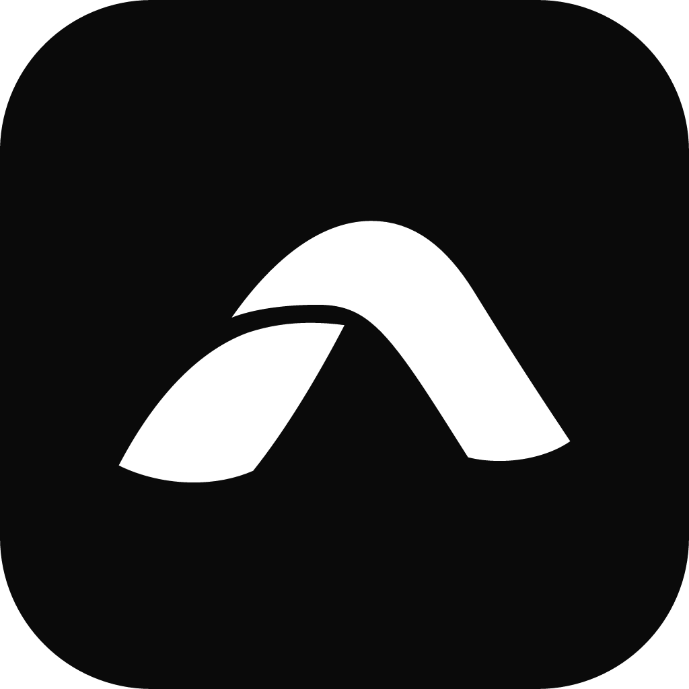
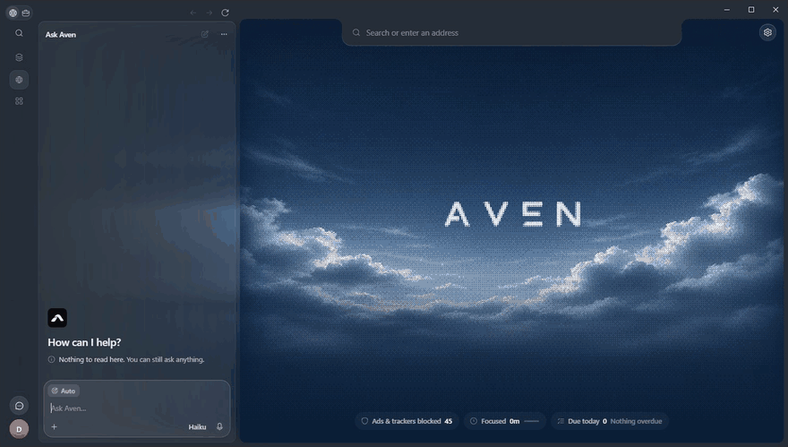
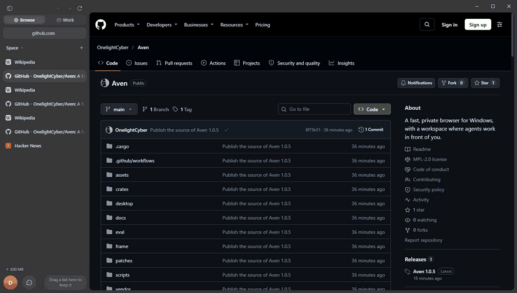
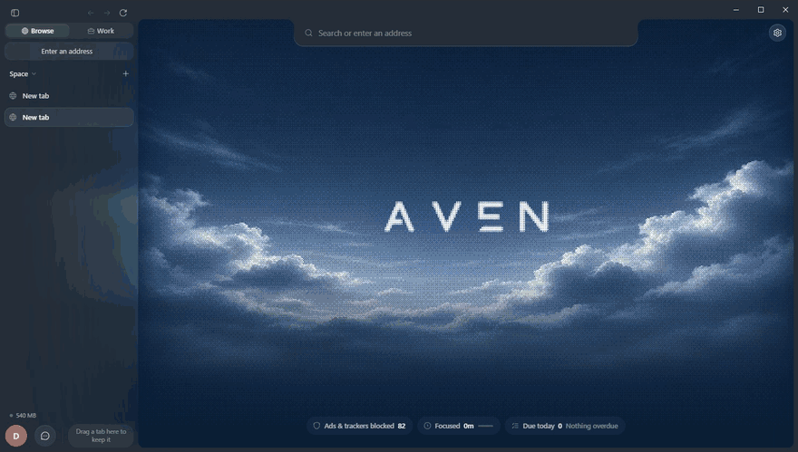
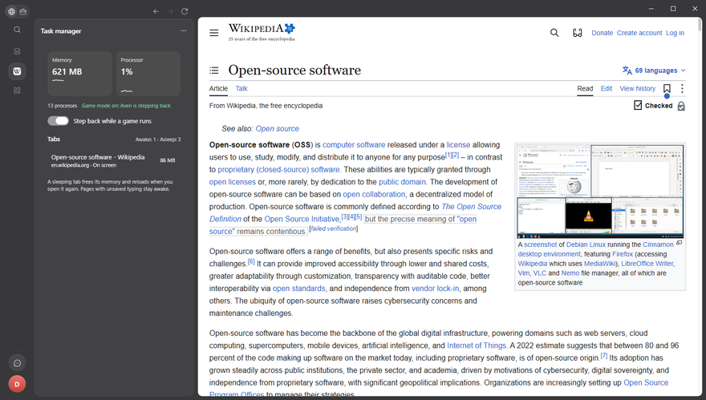

<div align="center">



# Aven

**A fast, private browser for Windows, with a workspace where agents work in front of you.**

[](https://github.com/OnelightCyber/Aven/releases/latest)
[](https://github.com/OnelightCyber/Aven/releases/latest)
[](LICENSE)


[Download](https://github.com/OnelightCyber/Aven/releases/latest) · [See it](#see-it) · [Features](#features) · [Privacy](#privacy) · [Build](#build-from-source) · [Docs](#documentation) · [Contributing](#contributing)

</div>

---

Aven keeps what a browser should do out of your way: tabs down the side, ads
and trackers blocked from the first launch, a password vault that stays on
your machine, and a game mode that hands the processor back to your game. It
has no account, no server of its own, and nothing to sign in to.

<p align="center">
  
  <br />
  <sub><b>Auto mode.</b> Give Ask Aven a mission: it searches, reads and clicks on its own, refuses the cookie prompt in its way, and answers with its sources.</sub>
</p>

> [!NOTE]
> Download `Aven-Windows-x64-setup.exe` from the
> [latest release](https://github.com/OnelightCyber/Aven/releases/latest),
> or [build Aven from source](#build-from-source). The installer is not
> code-signed yet, so Windows SmartScreen may name an unknown publisher:
> choose **More info**, then **Run anyway**, after checking the file against
> the release's `SHA256SUMS`.

## See it

<table>
<tr>
<td width="50%" valign="top">

<br />
<sub><b>A calm browser.</b> Tabs down the side, ads and trackers blocked from the first launch, light and dark.</sub>
</td>
<td width="50%" valign="top">

<br />
<sub><b>Agents act only with your yes.</b> An agent on your computer asks in the sidebar before it presses or types; you see its pointer and can stop it.</sub>
</td>
</tr>
<tr>
<td width="50%" valign="top">

<br />
<sub><b>Game mode.</b> When a game fills the screen, hidden tabs sleep and Aven steps back to below-normal priority.</sub>
</td>
<td width="50%" valign="top">

**Download** the installer from the
[latest release](https://github.com/OnelightCyber/Aven/releases/latest).
Aven updates itself, each update checked against the signing key built into
the app.

**No account, no server.** Your vault, history and settings stay on this
computer; AI runs on your own keys, your Claude Code subscription or a local
model.

</td>
</tr>
</table>

## Features

<table>
<tr>
<td width="50%" valign="top">

### Browse

- Vertical tabs in a sidebar, spaces, pinned tabs, previews
- Split view: two pages side by side
- Ads and trackers blocked (EasyList, EasyPrivacy, uBlock lists)
- Chrome extensions from the Chrome Web Store
- Separate profiles, import from other browsers
- A global launcher (`Ctrl` `Shift` `Space`) and shortcuts you can change

</td>
<td width="50%" valign="top">

### Stay private

- Cookie banners refused for you when the site offers a refusal, with the
  sites you choose left alone
- A vault for passwords, notes and two-factor codes, encrypted on disk; it
  saves the sign-in you typed on a page when you ask
- Streamer mode blurs your e-mail and the vault while you share your screen,
  and starts by itself when a recording program such as OBS runs
- Private windows keep nothing once closed
- No account and no Aven server

</td>
</tr>
<tr>
<td width="50%" valign="top">

### Play

- Game mode sees a game in front and puts hidden tabs to sleep
- Memory and processor limits for the whole browser
- A network speed limit, while you play or all the time
- A task manager that shows what each tab costs
- Discord, Twitch, WhatsApp and Spotify one click away, beside your page

</td>
<td width="50%" valign="top">

### Work with agents

- **Ask Aven** (`Ctrl` `E`): reads the page, answers, and acts on it for
  you: it clicks and types where a pointer shows you, and closes the boxes
  in its way
- **Work**: describe a result and watch it built step by step on a canvas
- Your own keys (Anthropic, OpenAI, Gemini, Mistral, and more) or a local
  model with Ollama or LM Studio
- A local MCP server lets tools such as Claude Code read your tabs and,
  with your yes, press and type on a page
- Anything that publishes or changes something waits for your approval

</td>
</tr>
</table>

Also there: a dark theme forced on sites that only come in light (and the
sites you leave out of it), a volume for each tab, a new tab
with tasks, notes and time spent per site, and Mica on Windows 11.

## Privacy

| | |
|---|---|
| **Accounts** | None. Aven has no server that receives your browsing. |
| **Where your data goes** | To the sites you visit and the model providers you choose. Microsoft Defender SmartScreen, on unless you turn it off, checks the sites you open and your downloads with Microsoft. Sync, off until you turn it on, goes through Aven's relay encrypted so the relay cannot read it. Every connection Aven makes on its own, and how to turn it off: [PRIVACY.md](PRIVACY.md). |
| **Passwords** | Encrypted with AES-256-GCM in a file on your disk. The key stays in the Windows Credential Manager. A saved sign-in is only ever filled on the encrypted site it was saved for. |
| **Model keys** | Kept in the system keychain, never in a file. |
| **Updates** | Aven checks GitHub for a new release, verifies its signature with the key built into the app, and installs it at the next launch. The check can be turned off in Settings. The web engine (WebView2) updates itself. |

Found a security problem? Please report it privately: see [SECURITY.md](docs/SECURITY.md).

### Code signing policy

How the Windows installer is signed, who approves each signature, and what is
signed: [docs/code-signing.md](docs/code-signing.md).

## Platforms

| Platform | State |
|---|---|
| **Windows 10 and 11** | What Aven is built and tested on. |
| **macOS** | The code is there, inherited from the project Aven is built on. This project has not built or tested it, and the vault, game mode, the network limit, forced dark mode, cookie refusal and the task manager are Windows only. |
| **Linux** | Not supported. |

## Build from source

You need [Rust](https://rustup.rs) (the version in
[`rust-toolchain.toml`](rust-toolchain.toml) installs itself), Node.js (the
version in [`.node-version`](.node-version)), pnpm through Corepack
(`corepack enable`), and the
[Tauri prerequisites](https://v2.tauri.app/start/prerequisites/): Microsoft
C++ Build Tools and WebView2 on Windows.

```sh
pnpm install --frozen-lockfile
pnpm dev      # run a development build
pnpm build    # package the browser
```

Development builds use a profile of their own (`app.aven.dev`), so they never
touch the one you browse with.

## Documentation

| | |
|---|---|
| [Architecture](docs/architecture.md) | Which part owns what: native hosts, the Rust core, the engine, the interface. |
| [Security model](docs/security-model.md) | What each boundary protects and how. |
| [Work](docs/work.md) | How the agent workspace is put together. |
| [Extensions](docs/extensions-user-guide.md) | Installing and using Chrome extensions. |
| [Ad blocking](docs/adblock.md) | The filter lists and how they are maintained. |

## Contributing

Bug reports, ideas and pull requests are welcome. Start with
[CONTRIBUTING.md](docs/CONTRIBUTING.md) for how to build, test and send a change,
and [CODE_OF_CONDUCT.md](docs/CODE_OF_CONDUCT.md) for how we treat each other.

## Licence

[MPL-2.0](LICENSE). Where the code comes from and who to credit:
[NOTICE.md](NOTICE.md). The filter lists in `assets/blocker-seed` keep their
own licences (CC BY-SA 3.0, GPL-3.0).
